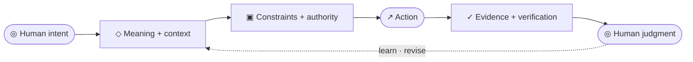

# Zach Shallbetter

### Product & Systems Engineer

**I build systems that make meaning explicit and actionable, grounded in how people understand the world, express intent, and evaluate the consequences of action.**

[Website](https://zachshallbetter.com) · [Selected work](https://zachshallbetter.com/work) · [Systems & principles](https://zachshallbetter.com/systems) · [Writing](https://zachshallbetter.com/writing)

I re-enter problems until they hold.

The throughline in my work isn't a particular language or framework. It's making the underlying structure of a problem legible, giving it a usable representation, and building systems that can act on it without losing track of human intent, authority, or evidence.

I've followed that problem through interaction design, software architecture, semantic reflection, creative tooling, AI, physical products, and manufacturing for more than twenty years. The breadth comes from following the problem wherever it leads. Some of the work is shipped software. Some is a protocol, a research program, or a reference implementation that tests whether an idea holds up in practice. The connection between them is the interesting part.

## From comprehension to dependable action

I think about systems as a relationship between what a person means, what the system understands, what it is allowed to do, and what everyone can verify afterward.

The goal is not to make people adapt to hidden system behavior. It is to make meaning and constraints explicit enough that people and machines can reason about them, act on them, and understand the consequences.

An agent's failure to understand a system is not always a model failure. Sometimes it is a system-design failure. Hidden state, ambiguous controls, missing context, and absent feedback can make the right action difficult to identify and the outcome difficult to verify.

## Computer use and agent interfaces

- **[Adobe MCP](https://github.com/zachshallbetter/adobe-mcp)** — Published MCP servers for InDesign, Illustrator, Photoshop, and After Effects. They expose real creative-document workflows so agents can operate on documents, structure, typography, effects, and exports, not just imitate a person clicking around.
- **[MCP-Tools](https://github.com/zachshallbetter/MCP-Tools)** — Browser automation and inspection built around WebDriver BiDi, with network interception, request and console monitoring, screenshots, element interaction, and Lighthouse-based analysis. Useful computer use needs observability: not only the action, but evidence of what happened and why.
- **[Blender MCP in Rust](https://github.com/zachshallbetter/blender-mcp-rs)** — An exploration of semantic tooling and spatial interaction for agents working with Blender.

## Semantic systems and reflection

I'm interested in what changes when software exposes its meaning and structure, instead of making every tool infer them from text, pixels, or convention.

- **[Reflective Index](https://github.com/zachshallbetter/reflective-index)** — A local semantic index of Python and Swift codebases, exposed through MCP. Agents can inspect symbols, navigate call relationships, and request bounded code slices. Unresolved relationships are reported rather than guessed; incomplete knowledge stays visible.
- **[Reflective Rust](https://github.com/zachshallbetter/reflective-rust)** — Research and a Rust reference implementation for provenance-aware semantic reflection. The executable workspace implements runtime semantic contracts and graph protocols while keeping proposed compiler reflection distinct from capabilities stable Rust actually provides.
- **[PYDocs](https://github.com/zachshallbetter/pydocs)** — A deterministic Python documentation-association extractor that normalizes source relationships into a shared transport shape for language-aware tools.
- **[Semantic Expression System](https://github.com/zachshallbetter/Semantic-Expression-System)** — An architecture for separating interface meaning and behavior from visual expression, with explicit contracts governing what a presentation may transform and what it must preserve. The repository describes this as a specification and qualified implementation candidate.
- **[Fundamental Engine](https://github.com/zachshallbetter/fundamental-engine)** — A renderer-agnostic relational field runtime. Host objects influence a shared field and receive its state back through measurements, events, projections, and feedback. It has a live demo, a published npm core, and an extensive test suite; the API remains pre-1.0.
- **[Text Diff Tool](https://github.com/zachshallbetter/text-diff-tool)** — A working diff interface and API that goes beyond character changes toward semantic comparison, explanations, and impact assessment.

## Protocols, evidence, and research

A recurring problem in agent systems is the gap between producing an artifact and establishing that it is correct, authorized, or complete. These projects explore different parts of that gap.

- **[Generative Relationship Protocol](https://github.com/zachshallbetter/grp)** — A reference implementation for representing human–AI work as a persistent, branchable graph rather than a disposable linear chat. Typed relationships and context capsules preserve how ideas derive from, branch from, and synthesize with one another.
- **[Intent and Evidence Project Engine](https://github.com/zachshallbetter/intent-evidence-project-engine)** — A project-agnostic operating protocol for agent-assisted engineering: declared intent, bounded work, explicit authority, empirical evidence, independent evaluation, and evidence-qualified promotion. The implementation includes a conformance validator and tested coordinator behavior.
- **[Formal Project Bootstrap](https://github.com/zachshallbetter/formal-project-bootstrap)** — A reusable project substrate for bounded agent autonomy. It makes sources of truth, authority, context, ready work, execution limits, evidence, recovery, and reconciliation explicit. Its governing thesis: autonomy increases as consequential ambiguity decreases.
- **[Foundations of Computational Interaction](https://github.com/zachshallbetter/foundations-of-computational-interaction)** — An interdisciplinary research program investigating whether interaction can be represented, measured, compared, and modeled more precisely. The repository includes a versioned knowledge corpus, a deterministic C reference substrate for a limited subset, and verification tooling. Empirical advantage remains an open question, not a claimed result.
- **[Orchestration Studio](https://github.com/zachshallbetter/Orchestration-Studio)** — An evolving operator control-plane project for authoring, validating, launching, and inspecting specialist workflows across a runtime fleet. Its design keeps workflow governance and operator visibility separate from the runtimes that execute work.

## Shipped tools and production systems

- **[YumYum](https://github.com/zachshallbetter/yumyum)** — A published, style-agnostic animation library for React and vanilla JavaScript.
- **[Image Inspector](https://github.com/zachshallbetter/Image-Inspector)** — A domain-specific command-line tool for print-and-cut production, extracting practical information from design files such as dimensions, spot colors, layers, and fonts.
- **[Stateful Elements](https://github.com/zachshallbetter/Stateful-Elements)** — An earlier exploration of putting state and state observation directly on DOM elements.
- **[Kinect-Node](https://github.com/zachshallbetter/Kinect-Node)** — Real-time Kinect sensor streaming and processing, including synchronized sensor data, skeletal tracking, and multi-sensor distribution.
- **[Ascent](https://zachshallbetter.com/work)** — A native SwiftUI learning app built around deriving readiness and progress from behavior rather than asking users to configure everything up front.

## How I work

Research and implementation are a feedback loop, not separate phases. I build something testable, look closely at where it breaks, and revise both the implementation and the model behind it. My process is iterative by design: ship, test, and ship again.

I apply the same discipline to agent-assisted development. I define constraints and sources of truth, create purpose-built workflows, audit the work, and verify results rather than treating plausible output as proof of completion.

My background also includes product and design leadership, teaching, entrepreneurship, and physical production. I took a hardware company from Kickstarter through a roughly $500K seed round and an end-to-end just-in-time manufacturing operation. That experience shaped how I approach software: a prototype is a start; the real test is whether the system works under real constraints.

## Companies

- **Snack Studio** — Product studio work grounded in the same practice of taking ideas from structure to working systems.
- **[Judgment Machines](https://judgmentmachines.com)** — Writing and research on AI, judgment, and the systems we build around consequential decisions, including my book *The Last Undo*.

## Writing and the ideas behind the work

- **[The Last Undo](https://judgmentmachines.com)** — My book.
- **[Why Interaction Became a Scientific Problem](https://zachshallbetter.com/writing/why-interaction-became-a-scientific-problem)** — Why interaction needs a more precise object of study.
- **[The Prompt Was Never the Point](https://zachshallbetter.com/writing/behavioral-alignment-in-ai)** — From prompt engineering toward explicit reasoning architecture and governance.
- **[Living Documentation](https://zachshallbetter.com/writing/living-documentation)** — The input-side contract for generative work.
- **[Distance from Gray](https://zachshallbetter.com/writing/distance-from-gray)** — The output-side argument for contracts that make probabilistic work dependable.
- **[All writing](https://zachshallbetter.com/writing)** · [Systems & principles](https://zachshallbetter.com/systems) · [Selected work](https://zachshallbetter.com/work)

Human comprehension is the starting point. Explicit structure is the method. Dependable action is the outcome.
